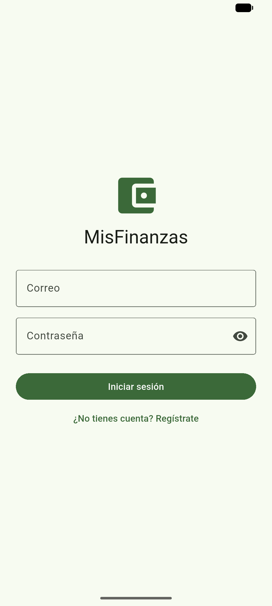
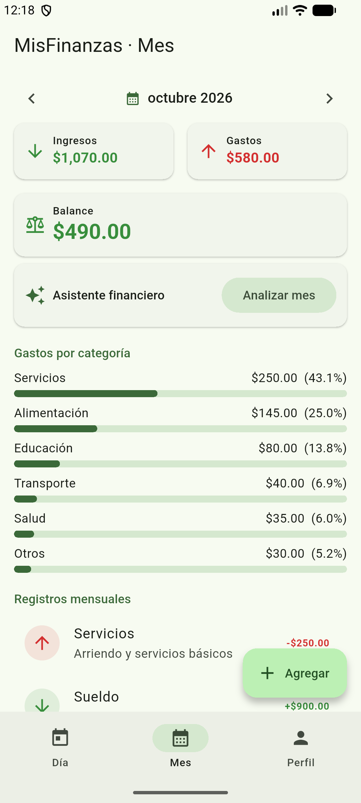
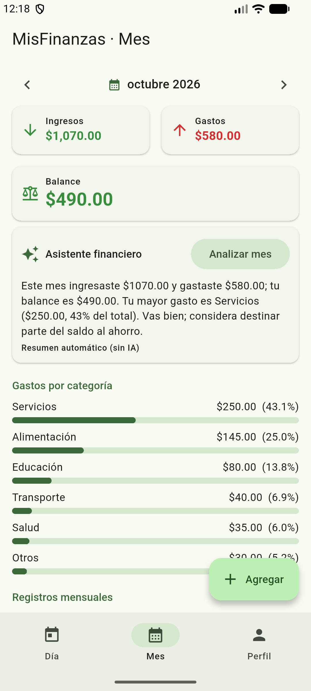
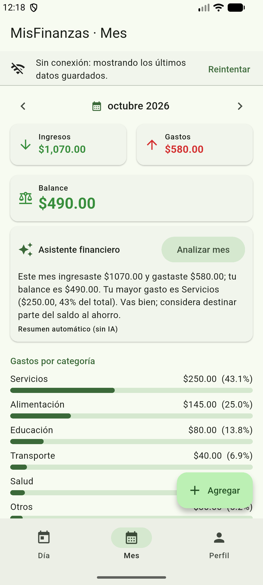

# MisFinanzas

App Android (Flutter) para registrar **ingresos y gastos por día y por mes**, con resumen, balance y un **asistente de IA** que analiza tu mes. Incluye backend propio (Dart + JWT).
Proyecto Final del curso *Desarrolla Aplicaciones Móviles Robustas con Flutter e IA*.

| Login | Resumen del mes | Asistente de IA | Sin conexión |
|---|---|---|---|
|  |  |  |  |

## Qué hace
- Registro, inicio y cierre de sesión (JWT; el token se guarda en almacenamiento seguro).
- CRUD de ingresos y gastos, en modo **por día** (fecha exacta) o **por mes** (monto mensual, fecha = día 1). Cada usuario ve solo lo suyo.
- Pestañas **Día** y **Mes**: totales, balance (verde/rojo), gastos por categoría y movimientos agrupados.
- **Asistente financiero** (pestaña Mes → *Analizar mes*): resumen y consejos del mes, generados en el servidor.
- Estados de **carga, vacío y error** distintos; mensajes diferentes para 400, 401, 422 y 5xx; modo sin conexión con los últimos datos guardados.

## Requisitos
- Flutter estable (probado con 3.47.7 / Dart 3.13) y Android SDK con un emulador.
- Dart (viene con Flutter) para el backend. No hace falta Node ni npm.

## Ejecutar paso a paso

### 1. Backend
```bash
cd backend
cp .env.example .env          # edita JWT_SECRET (mínimo 16 caracteres; p. ej. `openssl rand -hex 32`)
dart pub get
dart run bin/server.dart      # escucha en http://localhost:8080
```
La primera vez crea `backend/data/db.json` con un usuario demo y **24 movimientos** de ejemplo:
**demo@misfinanzas.app / demo1234**. (Puedes registrar tu propio usuario.)

`ANTHROPIC_API_KEY` en `backend/.env` es **opcional**: sin ella el asistente responde con un resumen automático local (la app lo indica como "sin IA"); con ella usa el modelo `AI_MODEL`.

### 2. App
```bash
flutter pub get
flutter run                                    # emulador: usa http://10.0.2.2:8080
```
Direcciones por entorno (`--dart-define=API_URL=...`):

| Entorno | API_URL |
|---|---|
| Emulador Android (por defecto) | `http://10.0.2.2:8080` |
| Teléfono físico | `http://<IP-de-tu-PC>:8080` (misma red Wi-Fi) |

### 3. Instalar el APK del Release
1. Descarga `app-release.apk` desde **Releases** del repositorio.
2. Si tienes instalada una versión de depuración: `adb uninstall com.example.misfinanzas`.
3. `adb install app-release.apk` (o arrástralo al emulador). Con el backend encendido en tu PC, el emulador lo alcanza en `10.0.2.2:8080`.

### Pruebas
```bash
flutter analyze && flutter test            # app
cd backend && dart analyze && dart test    # backend
```

## Arquitectura
```
 screens/  (UI, solo Obx y llamadas a controladores)
    │
 controllers/  GetX: AuthController, MovimientosController, NavController
    │
 services/  ApiClient (HTTP + errores) · Auth/Movimiento/Ia Service · TokenStorage · CacheLocal
    │                                     │ secure storage     │ shared_preferences
    ▼
 backend/ (shelf)  →  JWT middleware → rutas /auth /movimientos /ia/resumen  →  Store (JSON)
                                                                         └→ API del modelo de IA (clave solo aquí)
```
- Ninguna pantalla hace HTTP; `ApiClient` es la única salida de red.
- Persistencia local: última lista de movimientos (para verla sin conexión) y último correo; sobreviven al cierre de la app.

### API
| Método y ruta | Auth | Descripción |
|---|---|---|
| `POST /auth/registro`, `POST /auth/login` | No | Devuelven `{token, usuario}` |
| `GET /me` | Sí | Usuario actual |
| `GET/POST /movimientos`, `PUT/DELETE /movimientos/<id>` | Sí | CRUD del usuario autenticado |
| `POST /ia/resumen` `{mes:"yyyy-MM"}` | Sí | Resumen y consejos del mes |

Códigos: 400 JSON mal formado · 401 sin token/expirado · 404 no existe (o es de otro usuario) · 409 correo duplicado · 422 datos inválidos (con detalle por campo) · 500 error interno.

### Decisión técnica propia: backend en Dart y almacén JSON
- **Elegí** un backend propio en Dart (shelf) en lugar de Firebase o Node: la IA exige un servidor propio de todos modos, Dart ya viene con Flutter (quien evalúa no instala nada extra) y comparto el mismo lenguaje.
- **Descarté** Firebase (requiere cuenta y claves de proyecto, difícil de reproducir sin preguntarme nada) y Node (en mi equipo no había `npm`; además implicaba otra cadena de herramientas).
- **Almacén:** un archivo JSON con escritura atómica en vez de una base SQL: cero dependencias nativas y suficiente para el alcance. Limitación: no es para producción ni concurrencia alta; migrar a SQLite/Postgres solo afectaría a `store.dart`.
- **Contraseñas:** SHA-256 iterado (10 000 rondas) con sal aleatoria por usuario y comparación en tiempo constante. Con más tiempo usaría bcrypt/argon2.

## Seguridad
- El token JWT vive en `flutter_secure_storage` (Keystore de Android), nunca en `shared_preferences`.
- `JWT_SECRET` y `ANTHROPIC_API_KEY` solo existen en `backend/.env` (ignorado por git); se versiona `backend/.env.example` sin valores reales. La app no contiene ninguna clave de proveedor de IA.
- Las contraseñas no se guardan ni se devuelven; las rutas protegidas responden 401 sin token válido; un usuario no puede leer ni modificar movimientos de otro.
- El APK usa `usesCleartextTraffic` porque el backend de desarrollo es HTTP local; en producción habría que servir la API por HTTPS y quitar ese permiso.

## CI y Release
- `.github/workflows/ci.yml`: `analyze` y `test` de la app y del backend en cada push.
- `.github/workflows/release.yml`: al subir una etiqueta (`git tag v1.0.0 && git push origin v1.0.0`) compila el APK y lo publica en Releases.

## Créditos y licencias
Paquetes: [get](https://pub.dev/packages/get) (MIT), [http](https://pub.dev/packages/http) (BSD-3), [flutter_secure_storage](https://pub.dev/packages/flutter_secure_storage) (BSD-3), [shared_preferences](https://pub.dev/packages/shared_preferences) (BSD-3), [intl](https://pub.dev/packages/intl) (BSD-3), [shelf](https://pub.dev/packages/shelf) / [shelf_router](https://pub.dev/packages/shelf_router) (BSD-3), [dart_jsonwebtoken](https://pub.dev/packages/dart_jsonwebtoken) (MIT), [crypto](https://pub.dev/packages/crypto) (BSD-3). Iconos: Material Icons (Apache-2.0). Los datos de ejemplo son inventados por mí (`backend/lib/seed.dart`). Código desarrollado con asistencia de Claude Code y revisado por mí.
